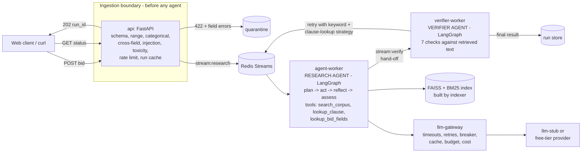

# TenderScreen - Public Procurement Bid Compliance Screening Service

**UE24AM342AA5 ML System Design & AgentOps - Mini Project 06 (Jackfruit)**
Team: PES1UG24AM256 · PES1UG24AM266 · PES1UG24AM269 · PES1UG24AM292

TenderScreen accepts a bid summary for a published tender, validates it, works
out which mandatory conditions are met or unmet, and routes the bid with a
cited justification to one of:

* **pass to technical evaluation**
* **seek clarification** from the bidder
* **recommend rejection** with the cited condition
* **escalate to a human** (the Tender Committee) - when the tender and central
  procurement rules conflict, the bidder category is unclear, the corpus
  cannot answer, the model is unavailable, or the answer cannot be verified

It **never qualifies or rejects a bid**. It produces a screening finding with
evidence; the Tender Committee decides.

Corpus: the closed IIT Palakkad tender TENDER/2024-25/370 (desktop
computers), the Department of Expenditure OMs of 25-07-2016 and 20-09-2016 on
relaxing prior turnover / prior experience for Startups and MSEs, and the
procurement chapter of the General Financial Rules 2017 (see
[corpus/manifest.json](corpus/manifest.json)).

---

## 1. Run it (from a clean clone)

You need **Docker Desktop** (Windows/macOS) or Docker Engine + Compose v2.24+
(Linux), about 4 GB of free RAM and 3 GB of disk, and internet **the first
time** (to pull images, install Python packages and download the 90 MB
embedding model). Nothing runs outside the containers.

```bash
git clone https://github.com/SasyakSubudhi/MLSDA-TenderScreen.git
cd MLSDA-TenderScreen
docker compose up --build
```

The first build takes 3-6 minutes. The system is ready when `api`,
`agent-worker` and `verifier-worker` show as *healthy*
(`docker compose ps` in a second terminal). The `indexer` container runs
once, builds the search index and exits with code 0 - that is expected.

Open:

| What | URL |
|---|---|
| **Web client** (submit a bid, see the routed finding with citations) | http://localhost:8000 |
| API documentation (OpenAPI) | http://localhost:8000/docs |
| Data contract | http://localhost:8000/v1/contract |
| Grafana dashboard | http://localhost:3000/d/tenderscreen |
| Jaeger traces | http://localhost:16686 |
| Prometheus targets | http://localhost:9090/targets |

Stop with `Ctrl+C` or `docker compose down` (add `-v` to also delete the
index, Redis data and dashboards' history).

### Try it

In the web client click an example (e.g. **startup low turnover**) and press
**Screen this bid**. Or from a terminal:

```bash
curl -s -X POST localhost:8000/v1/screenings -H "Content-Type: application/json" \
     -d @examples/startup_low_turnover.json
# -> {"run_id": "3f0c...", "status": "queued", "status_url": "/v1/screenings/3f0c...", ...}
curl -s localhost:8000/v1/screenings/<run_id>          # poll until "result" appears
curl -s localhost:8000/v1/screenings/<run_id>/trace    # full reconstruction of the run
```

(Windows PowerShell: use `curl.exe` instead of `curl`.)

### Use a real model instead of the stub

By default the model is the built-in `llm-stub` (OpenAI-compatible, fixed
responses after a realistic delay) so the system works offline and load tests
measure our system, not a provider's rate limit. To use a free-tier provider,
create a file called `.env` (it is git-ignored) with your provider's
OpenAI-compatible endpoint, key and model id:

```
LLM_PROVIDER_NAME=<provider>
LLM_BASE_URL=<https://.../v1>
LLM_API_KEY=<your key>
LLM_MODEL=<model id>
LLM_PRICE_INPUT_PER_1M=<list price>
LLM_PRICE_OUTPUT_PER_1M=<list price>
```

then `docker compose up -d`. Every option is documented in
[.env.example](.env.example); values in `.env` override it. No credentials,
endpoints or model identifiers are in the code.

---

## 2. What happens to a request



1. **Validate at the boundary** - schema, ranges, enumerations and cross-field
   rules (e.g. a startup must give a DPIIT number; class-I suppliers need
   >= 50% local content), prompt-injection and toxicity checks on every
   free-text field. Failures are quarantined with field-level errors and **no
   agent run starts**.
2. **Queue** - a run id is returned at once (HTTP 202); the client polls.
3. **Research agent** - classifies the bidder, retrieves the governing tender
   clause for each condition, decides whether another provision could modify
   it, derives new queries from what it read and searches the *policy* corpus,
   follows cross-references, then the rule engine computes each condition's
   status from the retrieved passages and the model drafts the justification.
4. **Verifier agent** (separate container) - checks every citation resolves to
   retrieved text, the cited evidence really supports each status, the route
   follows from the statuses, no invented numbers, no unauthorised
   determination. Fails -> retry with a different strategy -> escalate.
5. **Result** - route, basis, per-condition findings with quoted, page-numbered
   citations, the escalation path, and the verification report.

Details: [docs/ARCHITECTURE.md](docs/ARCHITECTURE.md),
[docs/AGENTS.md](docs/AGENTS.md), [docs/RETRIEVAL.md](docs/RETRIEVAL.md).

### The difficult case (section 4.1)

A recognised startup bids with average turnover Rs.8,80,000 against the
tender's Rs.24,00,000 threshold ([examples/startup_low_turnover.json](examples/startup_low_turnover.json)).
Read alone, tender clause 3(h)(2) says unmet. DoE OM 20-09-2016 para 2 says
ministries "have to ensure" prior-turnover criteria are relaxed for startups,
and GFR 2017 Rule 173(i) says they may be relaxed "subject to ... making
suitable provisions in the bidding document" - which this tender does not do.
TenderScreen returns **escalate to human** with both sides cited, not a
decision. Evaluation scenario `S02` is the reference answer.

---

## 3. Repository map

| Path | What | Part |
|---|---|---|
| `docker-compose.yml`, `Dockerfile`, `.env.example` | 10 services, one image, runtime config | 1 |
| `tenderscreen/common/` | config, JSON logging, tracing, Redis streams queue, run store | 1 |
| `tenderscreen/api/` | FastAPI service, data contract, rate limiter, web client | 1 |
| `contracts/` | published JSON schemas | 1 |
| `corpus/` | the four official PDFs, manifest with hashes, curated clause registry | 2 |
| `tenderscreen/retrieval/` | ingestion pipeline, normalisation, embeddings cache, FAISS+BM25 store | 2 |
| `eval/scenarios.json`, `tenderscreen/evaluation/` | 26-scenario evaluation set, metrics, batch runner | 2 |
| `tenderscreen/agents/` | research agent, verifier agent, tools, rule engine, guardrails, workers | 3 |
| `prompts/` | versioned prompt templates v1 and v2 | 3 |
| `tenderscreen/llm/` | LLM gateway, circuit breaker, client, stub provider | 4 |
| `observability/` | Prometheus, Grafana provisioning and dashboard | 4 |
| `loadtest/` | Locust file and scaling matrix | 4 |
| `docs/` | report, architecture, runbook, incident log, SLO, load test, demo | all |
| `tests/` | 44 unit/integration tests (no Docker needed) | all |

### Who built what

| Part | Owner (GitHub) | Scope |
|---|---|---|
| 1 - Platform, API and contracts | SasyakSubudhi | Compose/Dockerfile/config, shared runtime (`common/`), FastAPI service, data contract and quarantine, rate limiting, run cache, web client, architecture and demo docs |
| 2 - Corpus, retrieval and evaluation | vasun26shriya | corpus and clause registry, ingestion pipeline, embeddings cache, FAISS+BM25 search, 26-scenario evaluation set and metrics |
| 3 - Agents and guardrails | sujan1001 | research agent, verifier agent, tools, rule engine, guardrails, versioned prompts, queue workers |
| 4 - LLM ops, observability and load | yasho-26singh | LLM gateway (breaker, retries, cache, budget, cost), stub provider, Prometheus/Grafana, Locust load tests, runbook, incident log, report |

## 4. Commands

```bash
# evaluation batch (26 scenarios) and prompt comparison - inside the stack
docker compose exec agent-worker python -m tenderscreen.evaluation.run --compare v1 v2

# rebuild / update the index (idempotent; only changed chunks are embedded)
docker compose run --rm indexer
docker compose run --rm indexer python -m tenderscreen.retrieval.ingest --reembed-doc gfr_2017
docker compose run --rm indexer python -m tenderscreen.retrieval.ingest --check

# scale the research agent and load test (see docs/LOADTEST.md)
docker compose up -d --scale agent-worker=3
docker compose --profile loadtest run --rm locust --headless -u 10 -r 2 -t 90s --host http://api:8000

# unit tests without Docker (Python 3.12)
pip install -r requirements-dev.txt && pytest -q
```

## 5. Documents

* [docs/REPORT.md](docs/REPORT.md) - the project report
* [docs/DEMO.md](docs/DEMO.md) - the ten demonstration items, step by step
* [docs/RUNBOOK.md](docs/RUNBOOK.md) - two most likely failure modes
* [docs/INCIDENTS.md](docs/INCIDENTS.md) - incident log
* [docs/SLO.md](docs/SLO.md), [docs/LOADTEST.md](docs/LOADTEST.md) - target and measurements
* [docs/EVALUATION.md](docs/EVALUATION.md) - metrics, prompt comparison, deliberate change
* [docs/CONTRACTS.md](docs/CONTRACTS.md) - external interfaces

## Scope and limits

Historical, closed tender; not legal advice. Bidder categories and
certificates are the bidder's own declarations - authenticity is for the
committee. Guardrails are pattern/lexicon based. The rule engine covers the
five mandatory conditions of this one tender; adding a tender means adding its
clauses to the registry and its conditions to the engine.
