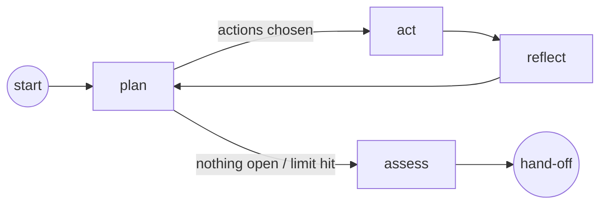

# Agent design

Two agents with distinct responsibilities, in two containers, connected by a
defined hand-off through Redis Streams. Both are LangGraph state graphs.

| | Research agent (`agent-worker`) | Verifier agent (`verifier-worker`) |
|---|---|---|
| Responsibility | gather evidence, classify bidder, compute statuses, draft | check the draft against retrieved text, decide accept / retry / escalate |
| Uses a model | yes - planning, query derivation, drafting | no - deterministic, so verification cannot be talked out of a failure |
| Tools | `search_corpus`, `lookup_clause`, `lookup_bid_fields` | none (reads the hand-off) |
| Input | `stream:research` `{run_id, attempt, strategy, prior_failures}` | `stream:verify` `{run_id, handoff}` |
| Output | hand-off: draft, all retrieved passages, profile, stats | final result, or a retry message back to `stream:research` |

## Research agent graph

* **plan** - builds the *candidate* actions from what is still unknown (bid
  fields not read, a condition with no governing clause yet, a derived query
  not yet run, a cross-reference not yet followed). If more than one is open,
  the model chooses up to 3 (prompt `plan`). The choice is validated against
  the candidate ids - the model cannot invent a tool or arguments. If the model
  is unavailable or answers badly, the first candidates are taken (fallback).
* **act** - runs the chosen tools: timeout 10 s each, one retry with backoff,
  counted against the tool budget, every call (arguments, latency, passages)
  written to the run trace.
* **reflect** - the step that makes this an agent rather than a pipeline:
  1. marks which governing clauses have now been found;
  2. for each condition whose clause it has read, evaluates it **on the tender
     alone**; if that says *unmet* (or the bidder claims an exemption) it
     decides another provision **might modify it** (step 2 of the brief);
  3. asks the model for search queries **derived from the clause text it just
     read** and the bidder category, aimed at the *policy* corpus (step 3);
  4. notices cross-references inside retrieved policy text (e.g. the
     20-09-2016 OM cites "O.M. of even number dated 25th July, 2016"; a DoE OM
     cites the "relevant provisions of GFR") and queues lookups for them.
* **assess** - the rule engine (`conditions.py`) computes every status
  **only from retrieved passages** (thresholds such as "Rs.5 Lakh", "three financial
  years", the Rs.17,600 EMD and the list of states are parsed out of the
  retrieved tender text); the route follows; the model drafts the
  justification citing evidence ids `[E1]`, `[E2]`...

### Tools

| Tool | Arguments | Returns |
|---|---|---|
| `search_corpus` | `query`, `family` = tender / policy / all, `mode` = hybrid / semantic / keyword, `k` | passages with chunk id, source, page, clause tags, text |
| `lookup_clause` | `clause_id` (e.g. `ANNEX-II-7`, `GFR-173`) | one intact clause |
| `lookup_bid_fields` | `fields` | bidder classification (F3) and extracted entities |

### Loop bounds (A1)

| Limit | Default | Setting |
|---|---|---|
| plan iterations | 12 | `AGENT_MAX_STEPS` |
| tool calls per attempt | 16 | `AGENT_MAX_TOOL_CALLS` |
| wall clock from submission (queue wait included) | 90 s (stub) | `RUN_TIMEOUT_S` |
| model call timeout | 30 s (and never past the deadline) | `LLM_CALL_TIMEOUT_S` |
| verification attempts | 2 | `MAX_VERIFICATION_ATTEMPTS` |

Hitting a limit with questions still open marks the run `incomplete` and it
is escalated - never returned as a confident answer.

## Verifier agent graph

`structure -> citations -> support -> text -> decide`

| Check | Fails when |
|---|---|
| V1 structure | a condition has no finding / draft malformed |
| V2 citations_resolve | a cited chunk was not retrieved in this run, or the quote is not verbatim in it |
| V3 required_support | a condition does not cite its tender clause; a CONFLICT lacks a cited policy provision |
| V4 status_entailed | re-running the rule engine on **only the cited passages** gives a different status |
| V5 route_consistent | route does not follow from the statuses, or is not one of the four allowed |
| V6 text_grounded | the text cites an evidence id that is not this finding's, or contains a number found neither in the bid nor in the cited quotes |
| V7 output_policy | (sanitises, does not fail) removes "the bid is rejected/qualified/awarded" style determinations and toxic words |

`decide`: all pass -> **accept**; otherwise, if attempts remain and the
deadline has not passed -> **retry** with strategy `keyword_lookup` (BM25
search plus exact clause lookup by identifier instead of hybrid search);
otherwise -> **escalate** with findings withheld and the retrieved passages
listed. An unverified answer is never returned.

## Routing (F6, F7)

1. Escalate if the run was incomplete or degraded, the bidder category is
   unclear (or consortium / foreign), or any condition is CONFLICT /
   ESCALATE / EVIDENCE_MISSING.
2. Else recommend rejection if any condition is UNMET - with the cited
   condition.
3. Else seek clarification if any condition is INSUFFICIENT (curable gaps).
4. Else pass to technical evaluation.

## Hand-off and mid-run failure

The hand-off message carries everything the verifier needs (the bid, the
classification, every retrieved passage, the draft, statistics), so the
verifier never needs to call back into the research agent. See
[ARCHITECTURE.md](ARCHITECTURE.md#failure-behaviour) for what happens when
either worker dies mid-run.

## Fallback path (graceful degradation, A5)

| Model call | Fallback when the model is unavailable |
|---|---|
| plan | take candidate actions in priority order |
| derive_queries | template query per condition and category |
| draft | template justification from the rule engine's basis text |

Any fallback caused by unavailability marks the run `degraded`; the route is
forced to **escalate** and the result is labelled *provisional*.
