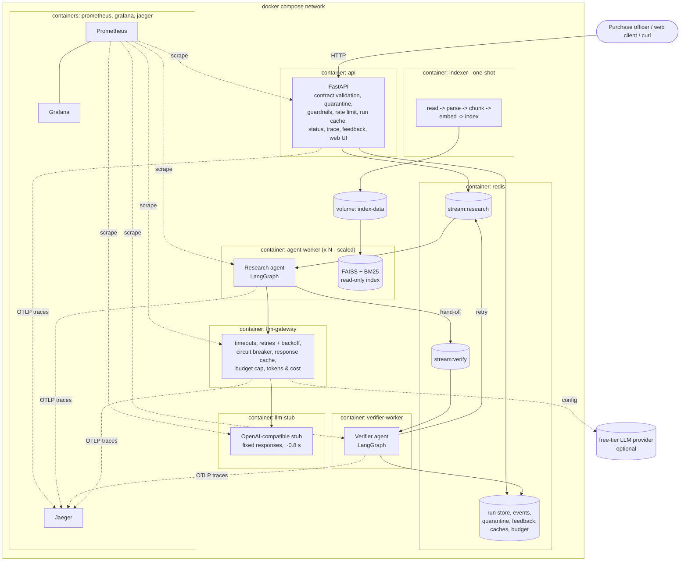

# Architecture and deployment boundaries

Each box with a heavy border is a separate container (deployment boundary).
A rendered version is in [img/architecture.png](img/architecture.png).

## Services (11, plus optional ones)

| Service | Role | Scales? |
|---|---|---|
| `api` | public REST interface, ingestion boundary, web client | 1 (stateless; could scale) |
| `agent-worker` | research agent | **yes** - `--scale agent-worker=3` |
| `verifier-worker` | verifier agent | 1 (fast; could scale) |
| `llm-gateway` | the only path to a model provider | 1 (breaker state is per process) |
| `llm-stub` | stand-in provider for demos and load tests | 1 |
| `indexer` | one-shot ingestion pipeline, exits 0 | - |
| `redis` | streams queue, run store, caches, limiter | 1 |
| `resource-exporter` | CPU, memory, uptime and restarts of **every** container (Docker API, read-only socket) | 1 |
| `prometheus`, `grafana`, `jaeger` | metrics, dashboard, traces | 1 |
| `locust` | load generator (profile `loadtest`, on demand) | - |
| `ollama`, `ollama-pull` | optional real model on the same machine, no key (profile `local-llm`) | - |

## Why the boundaries are where they are

| Boundary | Reason |
|---|---|
| **api** separate from the agents | *Failure isolation and resource profile.* The API must answer in milliseconds (202 + polling) even when every agent is busy or crashed; agents are slow and CPU/memory heavy (embedding model, index). |
| **agent-worker** (research) separate from **verifier-worker** | *Two agents, two processes* (A2). The verifier must not share failure modes or prompt context with the agent it checks. They also scale differently: research does ~8 tool calls and several model calls per run, verification is a few milliseconds of CPU. |
| **agent-worker** scalable | *Scaling.* Research is the throughput bottleneck (see LOADTEST.md), so it is the unit we replicate. Workers are stateless consumers of a Redis consumer group. |
| **llm-gateway** separate | *Independent release and failure isolation.* Changing provider, price, retry policy or breaker thresholds is a gateway redeploy only. One breaker protects all workers - N workers each hammering a dead provider would be N times the wasted latency. Budget and cost accounting are central. |
| **llm-stub** separate | *Replaceability.* It is swapped for a real provider by configuration only; it can be stopped or switched to `down`/`slow` to demonstrate the breaker without touching any other service. |
| **indexer** one-shot | *Resource profile and independent release.* Ingestion runs once per corpus change, not per request; its output is a volume the workers read. Re-indexing does not restart the API, and workers pick up a new index automatically (`meta.json` mtime). |
| **redis** | single small stateful service; everything else is stateless and can be restarted freely. |
| observability stack | standard images, no coupling to app releases. |
| **resource-exporter** separate | *Least privilege.* It is the only container that touches the Docker socket (read-only); nothing else gets that access. |

## Failure behaviour

* **Research worker dies mid-run** - its message stays pending in
  `stream:research`; after `QUEUE_LEASE_MS` (60 s) another worker reclaims
  it (`XAUTOCLAIM`) and re-runs the research stage. The trace shows a
  `redelivered` event. After 3 deliveries the message is dead-lettered and
  the run is returned as *escalated - failed*, never as a confident answer.
* **Verifier dies mid-run** - same mechanism on `stream:verify`; hand-offs
  wait in the stream until a verifier is back.
* **Provider down** - gateway retries with backoff, the breaker opens after 5
  consecutive failures and calls fail fast; agents switch to the fallback path
  (deterministic planning, template queries, template justification); the run
  is marked `degraded` and routed to **escalate**.
* **Run exceeds its deadline** (90 s from submission) - the agent stops, the
  run is marked `incomplete` and escalated.
* **Redis down** - the API health check fails (503) and submissions are
  refused; nothing is silently accepted.

## Asynchronous API - why polling

Runs take seconds to tens of seconds, so `POST /v1/screenings` returns `202`
with a run id at once and the client polls `GET /v1/screenings/{id}`. Polling
was chosen over callbacks because (1) the main client is a browser page, which
cannot receive a callback; (2) a callback needs an inbound network path and
retry logic towards every caller; (3) polling is idempotent and survives
client restarts. A Redis Streams queue sits between submission and execution,
so bursts at a tender deadline are absorbed by the queue rather than refused.
