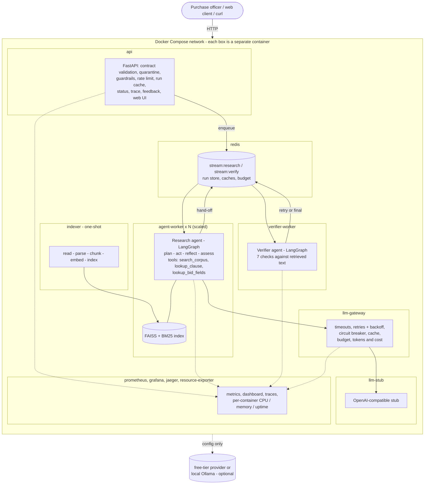

# TenderScreen - Project Report

**UE24AM342AA5 ML System Design & AgentOps - Mini Project 06**
Public Procurement Bid Compliance Screening Service
Team: PES1UG24AM256 · PES1UG24AM266 · PES1UG24AM269 · PES1UG24AM292

## 1. Problem and scope

Every bid for a public tender is screened for mandatory compliance (EMD,
turnover, past performance, documents, preference categories) before
technical evaluation, and a rejection must survive challenge. The hard part
is that the tender is not the only source of rules: central procurement rules
and Department of Expenditure orders relax or exempt some requirements for
startups and MSEs, and neither document cross-references the other.

TenderScreen is a multi-agent service that accepts a bid summary over a
documented REST contract, validates it at the boundary, determines which
mandatory conditions are met, and routes it - *pass to technical evaluation*,
*seek clarification*, *recommend rejection with the cited condition*, or
*escalate to the Tender Committee* - with a justification grounded in quoted,
page-numbered passages. It never qualifies or rejects a bid.

**Corpus** (all official, free, text layer, hashed in `corpus/manifest.json`):
the closed IIT Palakkad NIT **IITPKD/AR/RS/053/2018-19** (desktop computers;
published on the Central Public Procurement Portal per its clause 1.2;
closed 22-04-2019); DoE OM 25-07-2016 and OM 20-09-2016 on relaxing prior
turnover / prior experience for Startups and MSEs; GFR 2017 chapter 6.
Corpus confirmation, the section 4.1 passages and test values, and the
project plan: [EVALUATION_1.md](EVALUATION_1.md).

**Mandatory conditions screened:** C1 turnover of Rs.5 Lakh in each of
2015-16..2017-18; C2 three years in the desktop business and supplies to
CFTIs; C3 EMD of Rs.17,600 (bids without EMD rejected); C4 mandatory
documents; C5 registered office and service centre in KA/TN/TS/AP/KL; plus
C0 bidder category (F3).

**Out of scope:** document authenticity (declarations are taken as
declared), technical evaluation, live tenders, model training.

## 2. Agent design

Two LangGraph agents in two containers with a hand-off through Redis
Streams (full detail: [AGENTS.md](AGENTS.md)).

* **Research agent** - `plan -> act -> reflect -> plan ... -> assess`. Three
  tools the agent chooses to call: `search_corpus` (hybrid / semantic /
  keyword, restricted to the tender or the policy family), `lookup_clause`
  (by identifier) and `lookup_bid_fields` (the request's own fields + bidder
  classification). The model picks among allowlisted candidate actions,
  derives new queries from the clause it has just read, and drafts the
  justification. A **rule engine** - not the model - computes each status
  from retrieved passages only; thresholds (Rs.5 Lakh, three years,
  Rs.17,600, the list of states) are parsed out of the retrieved tender text.
* **Verifier agent** - deterministic, 7 checks: citations resolve verbatim to
  retrieved text; every condition cites its tender clause and a CONFLICT also
  cites the policy rule; re-running the engine on *only the cited passages*
  reproduces each status; the route follows; no stray numbers or foreign
  evidence ids; no unauthorised determination. Fail -> retry with a different
  strategy (keyword search + clause lookup) -> escalate. Unverified answers
  are never returned.
* **The five behaviours in section 5 of the brief:** (1) retrieve the
  apparent provision; (2) *reflect* decides whether another provision could
  modify it (tender says unmet, or an exemption is claimed); (3) search again
  with queries derived from the text read, and follow cross-references found
  in policy text; (4) verify in a separate agent; (5) retry differently or
  escalate.
* **Loop limits:** 12 plan steps, 16 tool calls, run deadline from submission
  (90 s with the stub), per-call model timeout, 10 s per tool call, per-task
  output-token caps, 2 verification attempts. Hitting a limit escalates.
* **Failure mid-run:** unacknowledged stream messages are reclaimed by another
  worker after 60 s; after 3 deliveries the run is dead-lettered and returned
  as *escalated - failed*.

## 3. Architecture and deployment boundaries

Eleven services under Docker Compose - `api`, `agent-worker` (scalable),
`verifier-worker`, `llm-gateway`, `llm-stub`, `indexer` (one-shot), `redis`,
`resource-exporter`, `prometheus`, `grafana`, `jaeger` - plus `locust`
(profile `loadtest`) and `ollama` (profile `local-llm`, optional real model).
Justification of each boundary (scaling, failure isolation, independent
release, resource profile, least privilege): [ARCHITECTURE.md](ARCHITECTURE.md).

## 4. Design decisions and what was rejected

| Decision | Alternative rejected | Why |
|---|---|---|
| Rule engine computes statuses from retrieved passages; the model plans, derives queries and writes text | model decides compliance | A rejection must survive challenge; deterministic statuses are reproducible and verifiable. The model's value is in finding the right evidence. |
| Deterministic verifier in its own container | LLM-as-judge in the same process | A judge of the same kind as the model it checks can be argued out of failures; two prompts in one process are not two agents. |
| Clause units with topic/category metadata + page windows; tender/policy family filter | page windows only, single search | Single-pass search does not surface a relaxation the request never mentions (measured: prompt v1, 7/28 wrong). |
| Hybrid BM25 + vector (reciprocal-rank fusion) | vectors only | Exact terms (EMD, Rule 170, MSEs) matter; hybrid also keeps the offline hash fallback accurate. |
| Local ONNX embeddings, model chosen at runtime (library default) | PyTorch sentence-transformers; model id in config | ~800 MB smaller image; no model identifier in the repository (D4). |
| Redis Streams consumer groups | Celery; plain lists | Pending-message reclaim gives crash recovery with no extra service. |
| Polling | callbacks | A browser client cannot receive callbacks; polling is idempotent. |
| Gateway service owning breaker, retries, cache, budget, cost | each worker calls the provider | One breaker for all workers; provider change = configuration change. |
| OpenAI-compatible stub; optional local Ollama | mock inside the code | Same code path as a real provider; fault modes (down/slow/flaky) for the reliability demo; a keyless real model for demos. |
| Docker-API resource exporter | cAdvisor | Works the same on Docker Desktop for Windows; one small read-only container. |
| TruLens with deterministic feedback functions | LLM-judged feedback | Exact, repeatable scores that match what the verifier enforces; no extra model calls. |
| Regex/lexicon guardrails + structural limits (allowlisted actions, fenced untrusted text, route enum) | ML classifiers | No downloads, deterministic; the model cannot set a status or route anyway. |

## 5. Evaluation results (before and after)

28 scenarios, run from the command line and recorded with TruLens
([EVALUATION.md](EVALUATION.md)). Metrics: groundedness, context relevance,
faithfulness, hallucination rate (definitions in EVALUATION.md).

**Prompt variants** (policy safeguard off, to isolate the prompt): v2 beats v1 on **route accuracy by 25 points
(0.750 -> 1.000)** and expected-passage recall 0.857 -> 1.000; v1 rejects the
section 4.1 case and the MSE-EMD conflict, v2 escalates both correctly.

**Deliberate change - top-k 4 -> 2 (prompt v2):**

| | groundedness | context relevance | faithfulness | hallucination rate |
|---|---|---|---|---|
| before (k=4) | 1.000 | 0.679 | 1.000 | 0.000 |
| after (k=2) | 1.000 | **0.954** | 1.000 | 0.000 |

Accuracy and recall unchanged (1.0), but 3 more tool calls and 15 % more cost
per run; k=4 kept as default.

**Faulty-model run** (every first draft cites an unretrieved passage): draft
groundedness 0.937 and hallucination 0.167 -> final 1.000 and 0.000; all 28
caught and retried; no unverified answer returned.

**Live model:** all 28 scenarios through a small open-weight model
on the laptop CPU via Ollama: **route accuracy 0.964 (27/28)**, groundedness
1.000, hallucination rate 0.000, faithfulness 1.000, median 113 s per run.
The section 4.1 case was escalated correctly. The one miss (S11: an MSE's
EMD exemption under GFR Rule 170 was not retrieved) led to the fix below.

**Policy safeguard (the fix for S11):** when a bidder claims a category, the
research agent always adds one fixed policy-family search for it, independent
of the model's queries. Ablation on the 28 scenarios: prompt v1 scores 0.750
with the safeguard off and **1.000 with it on**; v2 scores 1.000 either way.
A unit test reproduces the S11 miss and pins the fix.

## 6. Performance, bottleneck and cost

Measured on the team's laptop (Docker Desktop, WSL 2) with Locust, model
replaced by the OpenAI-compatible stub ([LOADTEST.md](LOADTEST.md)).

| research workers | p95 at 10 users | saturated throughput | highest load meeting p95 <= 30 s |
|---|---|---|---|
| 1 | 32.0 s (SLO missed) | 0.34 runs/s | 5 users |
| **3 (default)** | **9.2 s (SLO met)** | 1.02 runs/s | 20 users |

**Bottleneck: the research agent worker** - one run at a time, ~4 dependent
model calls, ~3 s per run, so throughput is replicas / 3 s; above that, runs
queue in `stream:research` and latency becomes queue wait. Scaling to three
replicas tripled throughput, which confirms it. CPU was not the limit (no
container above 0.3 of a core under saturating load). The deployment
therefore runs **three research workers by default**, which meets the SLO.

**Caching (measured, 3 workers, 10 users):** the gateway's LLM response cache
(72 % hit ratio) cut p95 from 11.0 s to 3.0 s (-73 %) and cost from USD 0.0526
to USD 0.0399 per 100 runs (-24 %), with 2.8x the throughput. Drafting
prompts carry each bid's figures and rarely hit, which caps the cost saving.

**Cost:** USD 0.055 per 100 runs (list price, prompt v2); largest driver the
drafting call (66 %), then planning (29 %).

## 7. What did not work / limitations

* **A real model missed a relaxation (S11) - fixed.** With the live local
  model the derived queries did not surface GFR Rule 170(i), so an MSE's
  claimed EMD exemption was recommended for rejection instead of escalated.
  The verifier cannot see evidence that was never retrieved, so the fix is
  on the retrieval side: the policy safeguard (section 5). The live-model
  figure of 27/28 was measured before the fix.
* **One research worker misses the SLO - fixed by the default.** p95 is 32 s
  at 10 users with one worker (target 30 s); the default is now three
  workers (p95 9.2 s).
* **Load tests use a stub model.** They measure our system, not a provider;
  a hosted free-tier provider's rate limit would be the bottleneck first.
* **CPU-only local model is slow** (~2 minutes per run), fine for evaluation,
  not for interactive use.
* **Declarations are taken as declared.** Document authenticity, technical
  evaluation and live tenders are out of scope.
* **Earlier attempts that failed:** single-pass retrieval (prompt v1) missed
  relaxations in 7/28 scenarios; an OCR-noisy policy scan needed a reprint
  clause (INC-03); a 2,048-token model context truncated drafting prompts
  (INC-10). Full list in INCIDENTS.md.

## 8. Runbook and incidents

[RUNBOOK.md](RUNBOOK.md) - provider unavailable / rate-limited; runs stuck
(worker down or index missing). [INCIDENTS.md](INCIDENTS.md) - ten real
incidents from development.
